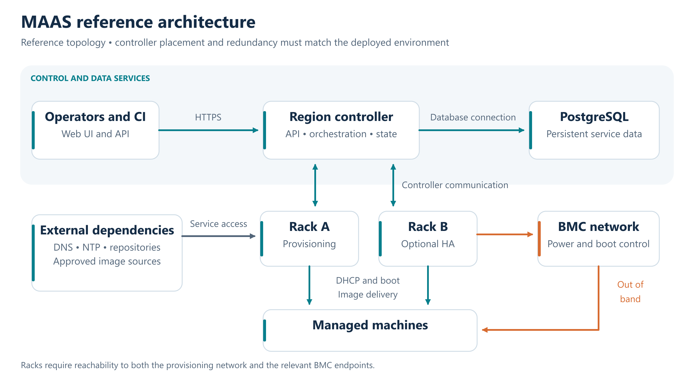
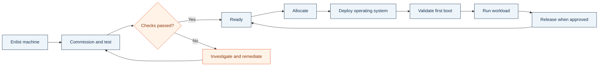

<div align="center">

# MAAS on Ubuntu
### Bare Metal Provisioning · Infrastructure Operations · Technical Handover

**A practical infrastructure project by Aref Shahsavari**

[](https://ubuntu.com/server)
[](https://maas.io/)
[](#operational-scope)

**From physical servers to a documented provisioning workflow.**

[Read the Operations Guide](docs/MAAS_Operations_and_Handover_Guide.pdf) · [Explore the Architecture](#reference-architecture) · [Review the Handover](#operational-handover)

</div>

---

## Overview

This project brings together an Ubuntu-based MAAS deployment and the documentation needed to explain, operate, and hand over the service to other infrastructure engineers.

Canonical MAAS (Metal as a Service) manages physical machines through discovery, commissioning, operating system deployment, and release. This repository presents the project architecture, the provisioning workflow, and the operational practices documented for the service. See [how MAAS works](https://maas.io/how-it-works).

The central deliverable is a **27-page Operations and Handover Guide** covering service configuration, network dependencies, machine lifecycle management, image engineering, troubleshooting, and recovery planning.

> **Project scope:** MAAS has been set up on Ubuntu. This repository publishes the project documentation. Architecture diagrams are reference designs; redundancy, recovery targets, release compatibility, and acceptance tests must be confirmed against the deployed environment. The repository does not include an automated installer or a complete infrastructure-as-code implementation.

## Why This Project

Installing a provisioning service is only one part of running it. Operators also need to understand how machines boot, where images come from, which network services must be available, and how to recover when a deployment fails.

This project organizes those concerns into a practical handover:

- **Understand the service:** map controller roles, dependencies, and management boundaries.
- **Provision consistently:** follow a defined path from hardware discovery to OS deployment.
- **Make changes traceable:** record release baselines, image versions, and configuration decisions.
- **Troubleshoot systematically:** investigate failures at the power, network boot, image, installation, or first-boot stage.
- **Prepare the next operator:** provide runbooks, ownership records, and acceptance criteria.

## Reference Architecture



The region controller handles operator-facing requests and orchestration. Rack controllers provide machine-facing provisioning services, including DHCP, network boot, image delivery, and power management. PostgreSQL persists MAAS service data. See Canonical's [controller documentation](https://canonical.com/maas/docs/stable/explanation/controllers/).

**Diagram interpretation:** the second rack controller illustrates an optional availability design. The diagram does not certify that redundancy or failover testing is implemented in this project. Controller placement and network reachability must match the actual deployment.

## Provisioning Workflow



This is a simplified operational workflow, including a remediation loop. It is not a complete MAAS API state diagram. Successful OS deployment is followed by workload-specific checks; it does not by itself establish application readiness. The canonical lifecycle is described in [MAAS: how it works](https://maas.io/how-it-works).

## Operational Scope

The guide covers the following areas. Coverage identifies documented procedures, not a claim that every optional capability has been enabled or tested.

| Area | Documentation focus |
| --- | --- |
| Service baseline | Ownership, release qualification, configuration register, and rebuild preparation |
| Networking | Fabrics, VLANs, subnets, address allocation, DHCP, DNS, time synchronization, and firewall dependencies |
| Hardware onboarding | Enlistment, commissioning, test results, power control, and qualification gates |
| Storage | Disk selection, storage layouts, RAID considerations, and change safeguards |
| OS deployment | Machine allocation, deployment preparation, CLI access, and first-boot validation |
| Image engineering | Standard images, custom Ubuntu images, build provenance, and promotion criteria |
| Security | Access controls, credential handling, TLS considerations, and operational boundaries |
| Automation | Configuration management principles, reproducibility, and execution evidence |
| Monitoring | Service health, capacity, operational indicators, and investigation workflows |
| Recovery | Backup scope, restore planning, dependency recovery, and recovery validation |
| Availability | Redundancy considerations and controlled upgrade planning |
| Handover | Acceptance tests, routine operations, escalation, and sign-off evidence |

## Start Here

1. **Read the architecture and service boundaries** to understand the controller roles and dependencies.
2. **Complete the service register** with the deployed Ubuntu and MAAS releases, installation method, controller endpoints, network design, and ownership.
3. **Review the deployment runbook** and adapt examples to the installed MAAS release.
4. **Qualify a non-production machine** through commissioning, deployment, and first-boot checks.
5. **Record the evidence** and complete the handover acceptance checklist.

For a new installation, first select a supported Ubuntu/MAAS combination using the [official MAAS documentation](https://canonical.com/maas/docs/). Installation, upgrade, and API behavior depend on the selected release.

## Documentation

| Resource | Purpose |
| --- | --- |
| [Operations and Handover Guide](docs/MAAS_Operations_and_Handover_Guide.pdf) | The main technical reference, including operating procedures, diagrams, recovery considerations, and acceptance criteria |
| [Reference Architecture](assets/maas-reference-architecture.png) | High-resolution architecture diagram for service walkthroughs and team handover |
| This README | Public project overview, technical scope, navigation, and contribution guidance |

### Repository Layout

```text
.
├── README.md
├── assets/
│   └── maas-reference-architecture.png
└── docs/
    └── MAAS_Operations_and_Handover_Guide.pdf
```

## Operational Handover

Before accepting responsibility for a deployed instance, the receiving team should have:

- A named service owner and an escalation contact.
- A reviewed configuration register and network diagram.
- Access through the approved identity and credential-management process.
- A successful commissioning and deployment record for representative hardware.
- An image inventory with the versions approved for deployment.
- A backup inventory and a recorded restore exercise.
- Agreed recovery objectives, maintenance procedures, and acceptance evidence.

Keep environment-specific credentials and restricted operational records in the organization's approved systems. The public repository should describe the approach and link to shareable documentation.

## Contributing

Corrections, clearer procedures, and additional validation notes are welcome. Open an issue or submit a pull request with:

- The affected section or procedure.
- The relevant MAAS and Ubuntu versions.
- The observed behavior and proposed correction.
- Sanitized evidence where it helps reproduce the issue.

Use labeled reference examples for network addresses and hostnames. Exclude API keys, BMC credentials, private keys, and customer information from issues, logs, and screenshots.

## Official References

- [Canonical MAAS](https://maas.io/)
- [MAAS Documentation](https://canonical.com/maas/docs/)
- [MAAS Controllers](https://canonical.com/maas/docs/stable/explanation/controllers/)
- [MAAS Machine Management](https://maas.io/docs/how-to-commission-machines-with-maas)
- [Canonical Packer MAAS](https://github.com/canonical/packer-maas)
- [cloud-init Documentation](https://cloudinit.readthedocs.io/en/latest/)

---

**Prepared and maintained by Aref Shahsavari**  
Ubuntu infrastructure · Bare metal provisioning · Technical documentation

This is an independent project using Canonical MAAS. Ubuntu and MAAS belong to their respective owners.
